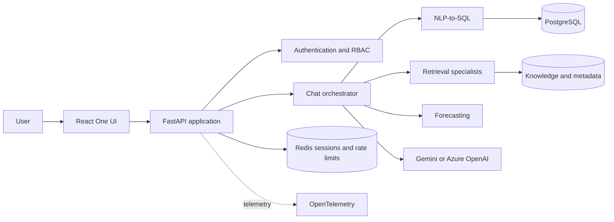

# Enterprise Conversational Analytics Assistant

[](https://github.com/Kunalgangwar1/enterprise-conversational-analytics-assistant/actions/workflows/ci.yml)


An end-to-end conversational analytics platform that turns natural-language questions into safe,
explainable data workflows. It combines NLP-to-SQL, specialist retrieval, deterministic forecasting,
interactive dashboards, role-based access control, and production-oriented observability in a single
React and FastAPI application.

> **Important:** This is a clean-room, learning-focused project built with synthetic healthcare
> examples. It does not contain proprietary code, production credentials, or real patient/member
> data. Do not use real sensitive data in the sample environment.

## Highlights

- **Natural language to SQL** with metadata-aware generation, validation, rewriting, and a separate
  read-only database connection.
- **Specialist assistant modes** for data discovery, knowledge catalog search, data quality,
  semantic exploration, forecasting, and access inspection.
- **Grounded answers** with retrieved evidence and citations.
- **Interactive analytics** with result tables, charts, follow-up prompts, and an aggregate dashboard.
- **Multi-provider AI** through Gemini and Azure OpenAI adapters, with deterministic modes available
  when no model credentials are configured.
- **Enterprise controls** including OIDC-ready authentication, RBAC, subject-owned sessions, request
  limits, security headers, privacy-safe logging, and SQL safety boundaries.
- **Production foundations** with Docker Compose, GitHub Actions, Terraform for AWS, OpenTelemetry,
  evaluation suites, and performance tests.

## Architecture



The frontend never receives database or model-provider credentials. Generated SQL is parsed and
validated on the backend, and execution uses a separately configured `SELECT`-only database role.
See [Architecture](docs/architecture.md) and [Security hardening](docs/security-hardening.md) for the
full design.

## Technology stack

| Layer | Technologies |
| --- | --- |
| Frontend | React 19, TypeScript, webpack, Recharts |
| Backend | Python 3.11+, FastAPI, Pydantic, SQLAlchemy, LangGraph |
| AI and retrieval | Gemini, Azure OpenAI, LanceDB, hierarchical and vector retrieval |
| Data and state | PostgreSQL 16, Redis 7 |
| Delivery | Docker Compose, GitHub Actions, Terraform, AWS ECS/Fargate |
| Operations | OpenTelemetry, ADOT, CloudWatch, X-Ray, Locust |

## Quick start with Docker

### Prerequisites

- Git
- Docker Engine with the Compose plugin

### Run the application

```bash
git clone https://github.com/Kunalgangwar1/enterprise-conversational-analytics-assistant.git
cd enterprise-conversational-analytics-assistant

cp .env.docker.example .env.docker
# Edit .env.docker and replace every placeholder password.

docker compose --env-file .env.docker up -d --build --wait
docker compose --env-file .env.docker run --rm seed
```

Open the application at [http://localhost:5173](http://localhost:5173):

- Chat: `http://localhost:5173/#/`
- Dashboard: `http://localhost:5173/#/dashboard`
- API documentation: `http://localhost:8000/docs`

The seed command is optional and loads deterministic synthetic data. Model-backed features require
provider settings in `.env.docker`; deterministic features such as Data Discovery and the Dashboard
work without model credentials.

Stop the stack without deleting its named volumes:

```bash
docker compose --env-file .env.docker down
```

For health checks, logs, database roles, and safe volume-reset instructions, see the
[Docker guide](docs/docker.md).

## Local development

### Prerequisites

- Python 3.11+
- [uv](https://docs.astral.sh/uv/)
- Node.js 18.18+ and npm
- PostgreSQL 16
- Redis 7 (when using shared sessions or distributed rate limiting)

Copy the backend environment template and configure at least the database URLs and development
identity:

```bash
cp .env.example .env
```

```dotenv
APP_ENV=development
AUTH_MODE=development
AUTH_DEV_SUBJECT=dev-user
AUTH_DEV_ROLES=analyst
```

Development authentication is intentionally rejected outside development, local, and test
environments. For production-style authentication, configure `AUTH_MODE=oidc` and the issuer,
audience, client, and JWKS settings described in the
[authentication guide](docs/authentication-authorization.md).

### Backend

From `backend/`:

```bash
uv sync --frozen --extra dev
uv run alembic upgrade head
uv run python -m app.db.seed
uv run uvicorn app.main:app --host 0.0.0.0 --port 8000 --reload
```

### Frontend

In another terminal, from `frontend/`:

```bash
npm ci
npm run dev
```

The development server runs on port `5173` and proxies `/api` and `/chat` to the backend on port
`8000`.

## AI provider configuration

Set `LLM_PROVIDER` to the provider used for generated responses:

```dotenv
# Gemini
LLM_PROVIDER=gemini
GEMINI_API_KEY=your-api-key
GEMINI_LLM_MODEL=your-model-name
```

```dotenv
# Azure OpenAI
LLM_PROVIDER=azure_openai
AZURE_OPENAI_ENDPOINT=https://your-resource.openai.azure.com
AZURE_OPENAI_API_KEY=your-api-key
AZURE_OPENAI_DEPLOYMENT=your-deployment-name
```

Keep all provider keys on the backend and out of source control. Embedding configuration is
independent of the response-generation provider. See [LLM configuration](docs/llm.md) and
[Knowledge Catalog](docs/knowledge-catalog.md) for details.

## Testing and quality checks

Backend, from `backend/`:

```bash
uv run pytest -m "not integration and not live_llm"
uv run ruff check .
uv run ruff format --check .
```

With the isolated PostgreSQL and Redis test services configured:

```bash
uv run pytest -m integration
```

Frontend, from `frontend/`:

```bash
npm run typecheck
npm test
npm run lint
npm run build
```

Run the deterministic, network-free evaluation profile from `backend/`:

```bash
uv run python -m app.evaluation.run --profile offline
```

Additional `integration` and `live` evaluation profiles are available but are never started
automatically. See the [evaluation guide](docs/evaluation.md).

## Repository structure

```text
.
├── backend/        FastAPI application, domain workflows, migrations, and tests
├── frontend/       React/TypeScript application and tests
├── docs/           Architecture guides and decision records
├── infra/aws/      Review-first Terraform for AWS deployment
├── observability/  Local OpenTelemetry Collector configuration
├── scripts/        Evaluation, performance, and operational utilities
├── compose.yaml    Local integration stack
└── .github/        CI, compatibility, release, and deployment workflows
```

## Documentation

| Topic | Guide |
| --- | --- |
| System design | [Architecture](docs/architecture.md) |
| API endpoints | [Backend API](docs/api.md) |
| Database and safe query execution | [Database](docs/database.md) |
| Authentication and authorization | [Authentication and RBAC](docs/authentication-authorization.md) |
| NLP-to-SQL | [NLP-to-SQL](docs/nlp2sql.md) |
| Specialist retrieval | [Knowledge Catalog](docs/knowledge-catalog.md), [Data Discovery](docs/data-discovery.md), [Data Quality](docs/data-quality.md) |
| Forecasting and dashboard | [Forecasting](docs/forecasting.md), [AI Dashboard](docs/ai-dashboard.md) |
| Privacy and security | [Privacy](docs/privacy.md), [Security hardening](docs/security-hardening.md) |
| Reliability and observability | [Reliability](docs/reliability.md), [Observability](docs/observability.md) |
| Performance and evaluation | [Performance](docs/performance.md), [Evaluation](docs/evaluation.md) |
| Delivery | [CI/CD](docs/ci-cd.md), [AWS deployment](docs/aws-deployment.md) |

Architecture decisions are recorded in [`docs/decisions/`](docs/decisions/).

## Deployment

The repository includes review-first Terraform for an AWS deployment using CloudFront, private S3,
an internal Application Load Balancer, ECS Fargate, RDS PostgreSQL, ElastiCache/Valkey, Cognito,
Secrets Manager, ECR, and GitHub OIDC.

Infrastructure is cost-bearing and is never applied automatically. Review the
[AWS deployment guide](docs/aws-deployment.md), example variable files, IAM permissions, and expected
costs before running Terraform.

## Contributing

Contributions and issue reports are welcome. Before opening a pull request:

1. Keep examples and fixtures synthetic.
2. Never commit `.env` files, credentials, generated secrets, or sensitive data.
3. Run the backend and frontend checks listed above.
4. Update the relevant documentation or architecture decision when behavior changes.

GitHub Actions repeats the backend, integration, frontend, evaluation, security, Compose, and image
build checks on pull requests and pushes to `main`.
